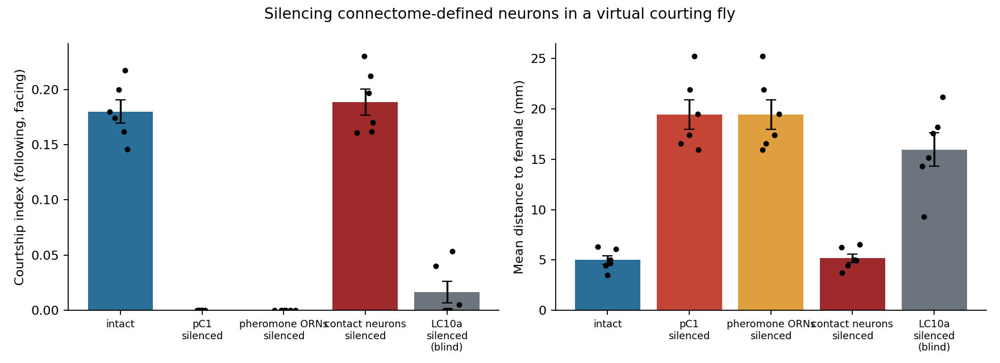
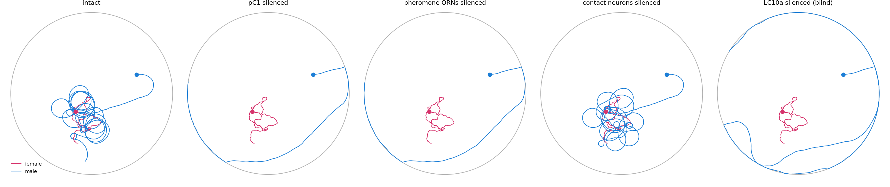

# Courtship in Silico

A virtual fruit fly whose brain is wired from the real **FlyWire whole-brain connectome**.
It smells a female's pheromones, becomes aroused, and chases her around an arena.
Silence a neuron type and the behavior breaks, the same way it does in real experiments.

https://github.com/user-attachments/assets/33276cd4-c84f-4422-92d6-03dcda9fcddc

## How it works

```
 female ──pheromone──▶ ORNs (Or67d/DA1, Or47b/VA1v) ──▶ projection neurons ─┐
        ──touch──────▶ fru+ ascending neurons ──────────────────────────────┤
                                                                            ▼
                                                      pC1 arousal hub (persistent)
                                                                            │ gates pursuit
        ──image──────▶ LC10a (left/right eye) ──▶ … ──▶ DNa02 / DNa01 ──────┴─▶ steering + speed
```

1. **`connectome.py`** loads FlyWire v783 (139k neurons, 15M connections) and extracts
   every neuron on a short path (≤ 3 synapses, ≥ 5 synapses per edge) between
   the sensory inputs, the pC1 arousal hub and the DNa02/DNa01 steering descending neurons.
   Result: **1,827 neurons, 88.5k signed connections**.
2. **`brain.py`** simulates that circuit as a leaky integrate-and-fire network with the
   constants of Shiu et al. 2024 (Nature). Synapse signs come from predicted neurotransmitters.
3. **`sim.py`** closes the loop: a 2D arena, a wandering female, and a male whose
   senses drive the input neurons and whose descending neurons drive his body.
4. **`run_experiments.py`** runs silencing experiments; **`make_video.py`** renders the demo.

## Results




| Condition | Courtship index | Mean distance (mm) |
|---|---|---|
| intact | 0.180 ± 0.011 | 5.0 ± 0.4 |
| pC1 silenced | 0.000 ± 0.000 | 19.4 ± 1.5 |
| pheromone ORNs silenced | 0.000 ± 0.000 | 19.4 ± 1.5 |
| contact neurons silenced | 0.189 ± 0.012 | 5.2 ± 0.4 |
| LC10a silenced (blind) | 0.016 ± 0.010 | 15.9 ± 1.7 |

6 trials × 30 s per condition (mean ± SEM). Courtship index = fraction of time within 5 mm of the female and facing her (±45°).
Silencing pC1 or the pheromone receptors abolishes courtship; blinding (LC10a) leaves the male aroused but unable to steer; silencing the contact channel has no effect because volatile pheromone alone is enough to arouse him in this model.

## What is real and what is modeled

Honesty matters more than a flashy demo, so here is exactly what comes from data:

| Component | Source |
|---|---|
| Neuron identities, synapse counts, signs | FlyWire v783 connectome (real data) |
| Neuron dynamics | LIF model, Shiu et al. 2024 parameters |
| **Left/right steering**: LC10a → DNa02 is ipsilateral | **Emerges from the wiring.** Driving right LC10a fires right DNa02 only, with no tuning |
| Pheromone ORN → PN responses | Emerges from the wiring |
| pC1 arousal | **Modeled.** In the LIF model, pheromone input does not recruit pC1 through synapses alone (tested on both the subcircuit and the whole brain). pC1 is instead driven by a slow integrator of PN + contact activity, reflecting the persistent arousal known from P1/pC1 studies |
| Arousal gating of pursuit gain/speed | **Modeled** (neuromodulatory in real flies, not visible in synaptic wiring) |
| Sensor/motor mappings, arena physics | Hand-designed |

### Caveats
- **FlyWire is a female brain.** Male pursuit uses male-specific P1 neurons; here the female
  homolog **pC1** stands in. The male CNS connectome (Janelia/Google) would be the natural next step.
- Foreleg contact-pheromone neurons (ppk23) project to the nerve cord, not the brain, so
  fru+ ascending neurons are used as a stand-in for the contact channel.
- The circuit is truncated to short paths, so long-range context is missing.

## Run it

```bash
pip install numpy scipy pandas pyarrow matplotlib imageio-ffmpeg
# data (~135 MB, public, no login)
mkdir data && cd data
curl -LO https://github.com/philshiu/Drosophila_brain_model/raw/main/Completeness_783.csv
curl -LO https://github.com/philshiu/Drosophila_brain_model/raw/main/Connectivity_783.parquet
curl -L -o annotations.tsv https://github.com/flyconnectome/flywire_annotations/raw/main/supplemental_files/Supplemental_file1_neuron_annotations.tsv
cd ..
python connectome.py
python run_experiments.py      # ~few minutes on a laptop CPU
python make_video.py
```

## Credits
- FlyWire Consortium: Dorkenwald et al. 2024; Schlegel et al. 2024 (*Nature*): connectome and annotations
- Shiu et al. 2024 (*Nature*): whole-brain LIF model and the connectivity files
- Courtship circuit biology: Kurtovic et al. 2007 (Or67d/cVA), Kohl et al. 2013, Hindmarsh Sten et al. 2021 (P1 gating of LC10a pursuit), Ribeiro et al. 2018 (LC10a)
- Built with Claude Code
